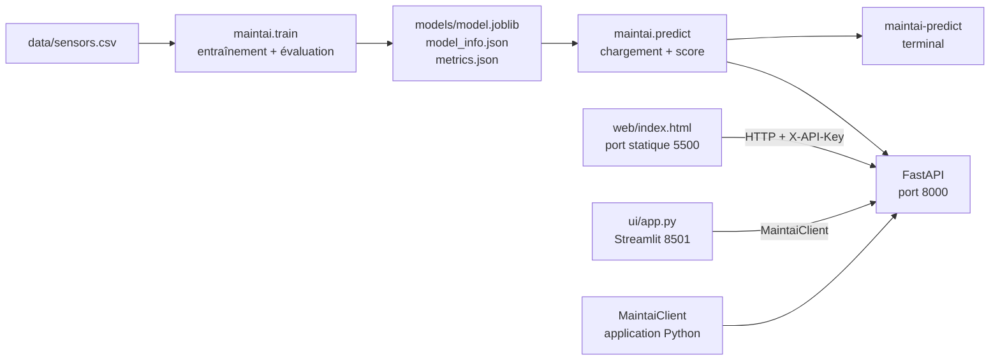

# Étude de conception — MaintAI

**Version : finale** · **Date : 12/11/2026**

Cette version décrit le système présent dans le starter TP4. Les données fournies sont synthétiques ; les performances observées ne démontrent pas la qualité du système sur des machines réelles.

## 1. Contexte et objectif

MaintAI estime le risque de panne d'une machine à partir d'un relevé de température, vibration, charge et durée de fonctionnement. L'objectif du projet pédagogique est de rendre cette prédiction accessible par API, interfaces et commande terminal, puis de distribuer le code sous forme de package Python.

## 2. Périmètre fonctionnel

- Générer un jeu synthétique ou charger un CSV ayant les colonnes attendues.
- Entraîner et évaluer un classifieur binaire face à une baseline.
- Produire une probabilité de panne et une alerte selon un seuil configurable.
- Exposer une API de santé et de prédiction.
- Consommer l'API depuis un client Web, une interface Streamlit et un client Python.
- Faire une prédiction depuis le terminal avec `maintai-predict`.

Le système ne pilote pas directement les machines.

## 3. Utilisateurs et scénario nominal

L'opérateur ou le démonstrateur fournit un relevé de capteurs et consulte la probabilité et l'alerte ; l'équipe qui maintient le projet génère les données, entraîne le modèle et lance les services. Le scénario nominal va du CSV à l'entraînement, puis du relevé à la prédiction via API ou commande.

Le schéma d'entrée de l'API refuse les champs inconnus et borne les valeurs. Le modèle expose une estimation, pas une décision de maintenance automatique.

## 4. Contraintes et exigences observables

- Les noms et l'ordre des variables doivent être identiques à l'entraînement et à la prédiction.
- Le modèle, ses métadonnées et ses métriques sont stockés sous `models/`; le jeu de données est sous `data/`.
- L'API est protégée par `MAINTAI_API_KEY`; `/health` reste public.
- Le navigateur ne peut appeler l'API que depuis les origines CORS configurées.
- Le package ne contient pas le modèle : l'environnement d'exécution doit recevoir le chemin du modèle.
- Les versions exactes de l'environnement d'entraînement sont consignées dans `requirements.txt`.

## 5. Contrat de prédiction

Entrée : `temperature_c`, `vibration_mm_s`, `load_pct` et `runtime_hours`. Sortie : `failure_probability`, `alert`, `threshold` et `model_version`. Le seuil par défaut est `0.3` et peut être réglé avec `MAINTAI_THRESHOLD`. Un relevé invalide est refusé par l'API ; le CLI signale explicitement l'absence du modèle.

## 6. Architecture et déploiement

Le jeu synthétique est généré par `maintai.dataset`; le découpage et la validation des colonnes sont dans `maintai.data`; le pipeline comprend une standardisation et une régression logistique dans `maintai.train`. L'API charge le modèle au démarrage. Elle écoute sur le port 8000 avec la commande documentée dans le README. Le serveur statique Web est lancé sur le port 5500 et Streamlit sur le port 8501. Ces processus peuvent être exécutés sur une même machine pour la démonstration ; en déploiement, les chemins, ports, origines CORS et secrets doivent être configurés pour l'environnement réel.

La clé API est lue depuis `MAINTAI_API_KEY`, par exemple via un fichier `.env` local ignoré par Git. CORS limite les origines Web autorisées mais ne remplace pas l'authentification. Le wheel distribue `maintai/` et la commande ; il ne distribue ni `models/`, ni `data/`, ni `ui/`. Le modèle doit être fourni séparément et son chemin configuré par `MAINTAI_MODELS_DIR`.

## 7. Choix technologiques et compromis

| Choix | Contrainte à laquelle il répond | Alternative ou compromis |
|---|---|---|
| Python, NumPy et pandas | Générer, transformer et inspecter les données dans le même langage que le modèle. | Un pipeline séparé dans un autre langage aurait ajouté une interface et des dépendances de déploiement. |
| scikit-learn et pipeline standardisation + régression logistique | Fournir un modèle supervisé simple, reproductible et sérialisable pour l'exercice. | Un modèle plus complexe ou un service d'apprentissage automatique externe n'est pas nécessaire pour cette démonstration ; le modèle reste à évaluer sur des données réelles. |
| FastAPI et Pydantic | Exposer un contrat HTTP validé et une documentation OpenAPI. | Un serveur Web fait maison demanderait de réimplémenter validation, erreurs et documentation. |
| `secrets.compare_digest` et clé API | Protéger les routes de prédiction avec une clé configurable et comparaison en temps constant. | Cette clé partagée n'apporte ni gestion d'identités ni rotation centralisée ; un système d'identité est requis en production. |
| Client Web HTML/JavaScript et client Python `httpx` | Montrer plusieurs consommateurs du même contrat HTTP. | Les clients restent séparés de l'entraînement et ne chargent pas eux-mêmes le modèle. |
| Streamlit | Construire une interface d'exploration et de démonstration en Python. | Une interface personnalisée offrirait davantage de contrôle, au prix d'un développement front-end et d'une maintenance supplémentaires. |
| `pyproject.toml`, entry point et wheel | Installer la commande et distribuer le code indépendamment du dossier source. | Le modèle n'est pas embarqué afin de garder sa distribution et les versions de son environnement explicites. |

Les groupes optionnels `api`, `ui` et `dev` séparent les dépendances de ces usages des dépendances de base du package. `requirements.txt` conserve des versions exactes pour reproduire l'environnement et recharger les artefacts du modèle.

## 8. Risques, éthique et confidentialité

- **Erreur de prédiction :** un faux négatif peut retarder une inspection et augmenter les risques de panne ou d'arrêt ; un faux positif peut provoquer une intervention ou un arrêt inutile. L'opérateur doit confronter le résultat à une inspection et aux procédures de sécurité, et garder la décision finale.
- **Biais et validité :** le jeu synthétique et le modèle illustratif ne représentent pas nécessairement les machines, capteurs, conditions de fonctionnement ou taux de panne réels. Le score ne doit pas servir seul à prendre une décision opérationnelle.
- **Données :** les colonnes actuelles décrivent une machine et ne demandent pas d'identité personnelle. Des données réelles pourraient néanmoins révéler l'activité d'un site ou d'un opérateur ; limiter leur collecte, leur accès, leur durée de conservation et leur partage.
- **Secrets et réseau :** ne pas committer `.env` ni exposer la clé dans des journaux ou dépôts publics. En production, utiliser HTTPS, gérer et renouveler les secrets, et restreindre le réseau. CORS n'empêche pas un appel direct à l'API.
- **Artefacts du modèle :** un fichier Joblib n'est pas un format sûr pour une source non fiable. Contrôler sa provenance et utiliser la version de scikit-learn enregistrée lors de son entraînement.

## 9. Limites et hors périmètre

Le système ne collecte pas de flux de capteurs, n'enregistre pas l'historique des prédictions, ne surveille pas la dérive des données et ne réentraîne pas le modèle automatiquement. Il n'inclut ni gestion multi-utilisateur, ni rôles, ni audit des décisions, ni haute disponibilité. Les données sont synthétiques et l'évaluation réalisée dans les tests ne garantit pas les performances en exploitation. La commande et le wheel nécessitent un modèle présent séparément ainsi qu'une version compatible des bibliothèques.

Avant tout usage réel, il faudrait valider le modèle sur des données représentatives, établir des seuils avec les responsables métier, mesurer les coûts des erreurs, sécuriser le déploiement et définir une supervision avec décision humaine.
